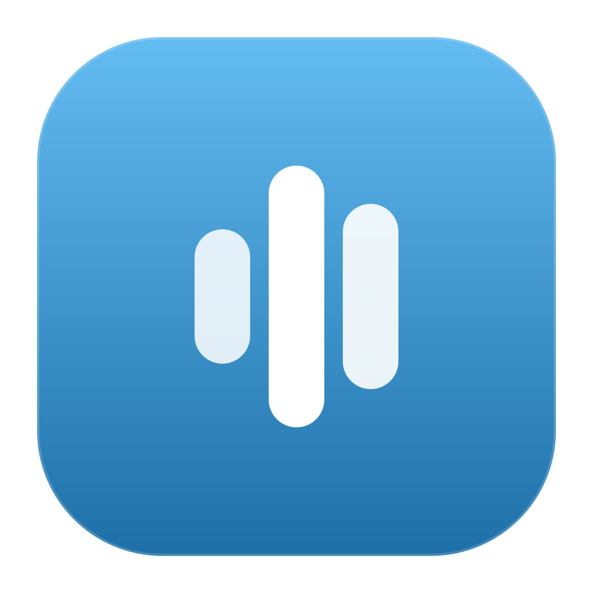

<div align="center">



# Bard

**Clipboard, Draw and Dictate.**

A small desktop companion for Windows and Linux that keeps what you copy, lets you say or sketch something new, and hands everything back on the clipboard.

[**Download**](https://miiso.dev/bard) · [How it works](#how-it-works) · [Shortcuts](#shortcuts) · [Privacy](#privacy) · [Repositories](#repositories) · [Building](#building)

[](https://github.com/miisodev/bard-releases/releases/latest)
[](https://github.com/miisodev/bard/actions/workflows/ci.yml)
[](./LICENSE)
[](https://miiso.dev/bard)
[](https://tauri.app)
[](https://github.com/sponsors/miisodev)


</div>

---

## What is Bard?

Bard only ever works with the one thing on your clipboard: it keeps it, shows it, swaps it for something you kept earlier, or adds to it by voice or by sketch. You still copy and paste the way you always have. Bard never types into another application.

It is free and open source under the MIT licence: no account, no telemetry, no sync and nothing to activate.

### Who it's for

Anyone who copies and pastes all day and keeps losing the thing they copied five minutes ago, or who would rather say a paragraph than type it, and wants both without a cloud service listening. It works the same on Windows, X11 and Wayland.

### From product to open source

Bard is [Miiso](https://miiso.dev)'s idea and his to maintain. It started as a paid Windows app. Version 4 was redesigned and rebuilt by Claude, Anthropic's Fable model, which he handed the project to, and it ships free and open: a program that reads everything you copy and listens to your microphone should be one you can read back.

### The core principle

> **Bard only touches the clipboard.**

Bard never injects keystrokes, never watches the screen and never reaches into another application. Everything it does goes in or out through the one clipboard you already use, so it works with every application and can never type into the wrong window.

### Design highlights

- **Keeps what you copy.** Text, links, colours, images and files, from any application, in one searchable history. Copies a password manager marks as private are never kept. A soft sound and a small badge at the top of the screen confirm each one; turn either off.
- **Three slots, one keystroke.** Your pinned items, then your most recent, fill slots 1 to 3. Put any of them back on the clipboard from anywhere, or cycle through them and watch the badge show where you are.
- **Shows you the clipboard.** One shortcut reads back what is on it right now.
- **Dictates on your own machine.** Hold a key and talk, or tap to start and tap to stop. A local speech model turns it into text, reads it back to you and puts it on the clipboard. Audio never leaves the computer.
- **Draws.** Pen, arrows, shapes and text on a page of its own; copy it as an image or save it as SVG.
- **Stays out of the way.** Bard lives in the tray. Its windows come when you call them and tuck away when you click elsewhere.

---

## How it works

```
 any app ──copy──▶ clipboard ──▶ Bard keeps it ──▶ history + slots 1–3
                       ▲                                   │
                       └────── shortcut puts it back ◀─────┘

 microphone ──▶ local speech model ──▶ text ──▶ clipboard
 Draw window ──────────────────────────▶ PNG ──▶ clipboard
```

- **Capture.** On Windows a hidden clipboard-listener window hears every copy; on X11 and XWayland, Bard watches the selection with XFixes, which is how a Wayland copy is heard on GNOME. A copy Bard cannot read is retried, and if it still cannot be read the badge says so.
- **Shortcuts.** One table drives `RegisterHotKey` on Windows, `XGrabKey` on X11 and the GlobalShortcuts portal on Wayland. A chord another application already owns fails visibly instead of silently.
- **Dictation.** Recording, resampling to 16 kHz, voice-activity detection and inference all run in the app, through the `transcribe-cpp` GGML engine. The model unloads after five idle minutes.
- **Storage.** One SQLite database is the single source of truth for history, slots and settings.

## Install

Downloads for Windows (installer) and Linux (`.deb`, `.rpm`) are at [miiso.dev/bard](https://miiso.dev/bard) and on the [releases page](https://github.com/miisodev/bard-releases/releases/latest), with checksums, an SBOM and provenance. Bard is also on the [Microsoft Store](https://apps.microsoft.com/detail/9PBLVGFCJ5V1).

The Windows installer is not Authenticode-signed, so SmartScreen shows a "Windows protected your PC" prompt the first time; choose **More info → Run anyway**. Updates are verified against an Ed25519 key built into the app before they install.

## Shortcuts

Change any of them in **Settings → Shortcuts**, the same way on Windows, X11 and Wayland: press the new keys, then Save. Save checks the whole table first and marks any shortcut that clashes with another one, or with a key your desktop or another app already uses, so nothing is saved that would not work. **Restore defaults** brings back the set below. On Wayland your desktop shows the keys once to confirm them.

| Action | Default |
| --- | --- |
| Show or hide Bard | `Alt+Shift+V` |
| Dictate: hold to talk, tap to toggle | `Alt+Shift+Space` |
| Copy slot 1 / 2 / 3 | `Alt+Shift+1` / `2` / `3` |
| Cycle through the slots | `Alt+Shift+C` |
| Show what is on the clipboard | `Alt+Shift+P` |
| Pause or resume keeping copies | `Alt+Shift+X` |
| Open Draw | `Alt+Shift+D` |
| Open Settings | `Alt+Shift+,` |
| Show the shortcut guide | `Alt+Shift+/` |

In the main window: `↑` `↓` move, `Enter` copies and closes, `Shift+Enter` copies and stays, `Ctrl+P` pins, `Ctrl+S` keeps forever, `Del` deletes, `F2` edits, `Ctrl+F` searches, and `Esc` steps back.

## Speech models

Bard offers two models and runs nothing else. Each is an open-weight model, converted to GGUF, hosted at [miisodev/bard-models](https://github.com/miisodev/bard-models) and pinned in the app by exact size and SHA-256; a download is hashed and loaded before it is ever used.

| Model | Upstream | Size | |
| --- | --- | --- | --- |
| **Bard Fast** | `nvidia/parakeet-tdt-0.6b-v3` (CC-BY-4.0) | about 580 MB | Quick, in 25 languages. The place to start. |
| **Bard General** | `Qwen/Qwen3-ASR-1.7B` (Apache-2.0) | about 1.6 GB | Slower and more accurate, in 30 languages. |

## Privacy

Bard has no account, no telemetry and no sync. Your history, your audio and your drawings stay on your computer. Bard uses the network for two things only: downloading a speech model when you ask for one, and checking for updates. The source is here so you can check that for yourself.

---

## Repositories

Bard lives in three public repositories:

| Repository | What it holds |
| --- | --- |
| [**miisodev/bard**](https://github.com/miisodev/bard) | The application source (this repository), its CI and release tooling. Each release is an annotated `vX.Y.Z` tag. |
| [**miisodev/bard-releases**](https://github.com/miisodev/bard-releases) | The published installers and Linux packages, the updater signature and manifest, `SHA256SUMS`, SBOMs and provenance for every release. |
| [**miisodev/bard-models**](https://github.com/miisodev/bard-models) | The speech-model files Bard downloads, their manifest of hashes, and the upstream licences and notices. |

The product page is [miiso.dev/bard](https://miiso.dev/bard); it also serves the update feed the app reads.

## Architecture

Tauri 2 (Rust + React/TypeScript/Vite), SQLite as the single source of truth. The Rust core owns every privileged path; the webview only draws.

- `src-tauri/src/monitor.rs` — clipboard capture: `AddClipboardFormatListener` on Windows, XFixes selection watching on X11 and XWayland. Privacy-marked copies are never kept, and Bard's own writes never re-enter its history.
- `src-tauri/src/shortcuts.rs` — the one shortcut table and its three backends, with the conflict check that Save runs.
- `src-tauri/src/linux_portal.rs` — the Wayland GlobalShortcuts portal session.
- `src-tauri/src/dictation/` — cpal recording (device-selectable), rubato resampling to 16 kHz, earshot VAD (pure Rust), and the `transcribe-cpp` engine.
- `src-tauri/src/db.rs` — the schema, the migrations and every query. A change to a Rust struct breaks the webview with no compile error, so `src/types.ts` mirrors it by hand and both change together.
- `src/` — the main window (`components/Clipboard.tsx`), the settings window, the status pill, the shortcut guide and the Draw window. No router, no state library, no CSS framework: the design tokens in `src/styles/tokens.css` are the whole visual language, and `scripts/css-audit.mjs` checks them.

## Building

Prerequisites: Rust (the pinned toolchain in `rust-toolchain.toml`), Bun, and on Linux the GTK 3 / WebKitGTK 4.1 development packages; on Windows, MSVC Build Tools, CMake and WebView2 (present on current Windows 10/11 installations; the installer can bootstrap it when a clean machine needs it).

```sh
bun install --frozen-lockfile
bun run tauri dev      # develop
```

A local Windows release (the NSIS installer plus its updater signature) is built by `scripts/build-release.ps1`, not by a bare `tauri build`:

```powershell
.\scripts\build-release.ps1 -Unsigned
```

Linux packages are built in the pinned `ubuntu:22.04` container, because a build on a newer distribution demands a glibc its users do not have.

## Development

```sh
bun run build
bun audit
cargo fmt --manifest-path src-tauri/Cargo.toml --all -- --check
cargo clippy --locked --manifest-path src-tauri/Cargo.toml --all-targets -- -D warnings
cargo test --locked --manifest-path src-tauri/Cargo.toml
cargo audit --file src-tauri/Cargo.lock   # cargo install cargo-audit
```

`cargo audit` reads `src-tauri/Cargo.lock` explicitly; there is no `Cargo.lock` at the repository root, so a bare `cargo audit` looks in the wrong place. CI runs the same gates on every push and pull request, then builds the Windows and Linux candidates, and `native-smoke.yml` installs a candidate on clean Windows and Linux runners and drives it.

The model release gate is `cargo test smoke_test_exact_models_when_requested` against the staged files. Set `BARD_SMOKE_MODELS` (and `BARD_SMOKE_WAV` for transcription) only when running against the staged model files; the smoke tests are no-ops otherwise.

## Contributing

Contributions are welcome: bug reports, fixes, documentation and ideas.

1. **Open an issue first** for anything non-trivial, with the version (Settings → About), the platform and desktop, and steps to reproduce.
2. **Fork and branch**, keep changes focused, and match the existing code style.
3. **The gates above must pass**, and a change to native behaviour needs a test or a note on how it was checked on a real desktop.
4. **Use conventional commits** (`fix:`, `feat:`, `docs:`, `refactor:`).

## Security

Please do not report a suspected vulnerability in a public issue. Follow the private process in [`SECURITY.md`](./SECURITY.md).

## Support

For help, open a [GitHub issue](https://github.com/miisodev/bard/issues) or write through [miiso.dev/contact](https://miiso.dev/contact).

Bard is free and maintained by one person. If it is useful to you, sponsorship funds its continued development:

<div align="center">

[](https://github.com/sponsors/miisodev)
[](https://paypal.me/miisodev?locale.x=en_US&country.x=ZA)

</div>

Starring the repository, reporting bugs and telling people about it help too.

## License

[MIT](./LICENSE) © [Kevin Miiso Novo](https://github.com/miisodev)

## Credits

- [Tauri](https://tauri.app): the shell that makes a small native app out of Rust and a web view.
- [transcribe.cpp](https://github.com/handy-computer/transcribe.cpp) and [ggml](https://github.com/ggml-org/ggml): the local speech engine.
- [NVIDIA Parakeet](https://huggingface.co/nvidia/parakeet-tdt-0.6b-v3) and [Qwen3-ASR](https://huggingface.co/Qwen/Qwen3-ASR-1.7B): the speech models, with the GGUF conversions from [handy-computer](https://huggingface.co/handy-computer).
- [meodai/color-names](https://github.com/meodai/color-names): the names Bard gives the colours you copy.
